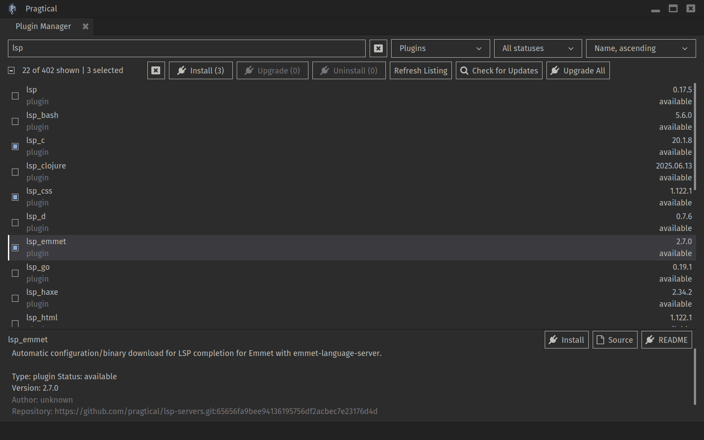

# Pragtical Plugin Manager (ppm)



`ppm` manages Pragtical plugins, colors, fonts, and editor installations. It
includes the Plugin Manager UI for searching, filtering, and managing addons.

Both are bundled with official Pragtical releases. Open **Plugin Manager: Show**
from the command palette (`Ctrl+Shift+P`) to use the UI.

The UI plugin requires Pragtical 3.10.0 or later.

Release builds use the manifest from this repository's `latest` branch by default.
See the [changelog](CHANGELOG.md) for release history.

## Installation

Download binaries for your platform from the
[latest release](https://github.com/pragtical/plugin-manager/releases/tag/latest)
or the [continuous build](https://github.com/pragtical/plugin-manager/releases/tag/continuous).

### Windows

Run in PowerShell:

```powershell
Invoke-WebRequest -Uri "https://github.com/pragtical/plugin-manager/releases/download/latest/ppm.x86_64-windows.exe" -OutFile "ppm.exe"
.\ppm.exe install plugin_manager --assume-yes
```

Alternatively, install the standalone binary with Scoop:

```powershell
scoop install https://raw.githubusercontent.com/pragtical/plugin-manager/refs/heads/master/pragtical-plugin-manager.json
```

### Linux And macOS

For Linux x86_64:

```sh
curl -fL https://github.com/pragtical/plugin-manager/releases/download/latest/ppm.x86_64-linux -o ppm
chmod +x ppm
./ppm install plugin_manager --assume-yes
```

For macOS, replace the asset name with `ppm.x86_64-darwin` or
`ppm.aarch64-darwin`. Use `ppm.aarch64-linux` for Linux ARM64.

Restart Pragtical after installing the UI plugin.

## Usage

```sh
ppm list
ppm install editorconfig
ppm uninstall editorconfig
ppm update
ppm upgrade
ppm --help
```

Use `pragtical pm` in place of `ppm` to invoke the editor's bundled binary.
For automated installation, pass `--assume-yes` and `--userdir=<directory>`.

## Building

Requires a C compiler, Python 3, Meson, Ninja, and Git. Meson uses system
libraries when available and downloads missing dependencies through wraps.

```sh
git clone https://github.com/pragtical/plugin-manager.git
cd plugin-manager
meson setup build --buildtype=release -Dstatic=true
meson compile -C build
./build/ppm --help
```

On Windows, the executable is `build/ppm.exe`. The `static` option embeds the
Lua program so ppm can run without the source tree; it does not make the
executable fully statically linked.

Dependencies are Lua, mbedTLS 4/TF-PSA-Crypto, libgit2, zlib, liblzma, and libzip.
The `microtar` sources are vendored in `lib/microtar/`. No Git submodule checkout
or CMake build is needed.

### Static Dependencies

Build dependencies from the supplied wraps, as CI does:

```sh
meson setup build-fallback --buildtype=release --wrap-mode=forcefallback \
  -Dstatic=true
meson compile -C build-fallback
```

Linux release builds also use `-Dfully_static=true` and a musl compiler to
avoid requiring a dynamic loader on the target system.

### Cross-Compilation

For Windows from Linux, install MinGW-w64 and run:

```sh
meson setup build-windows --buildtype=release --wrap-mode=forcefallback \
  --cross-file=cross/x86_64-w64-mingw32.ini -Dstatic=true
meson compile -C build-windows
```

The output is `build-windows/ppm.exe`. Additional files in `cross/` cover Linux
aarch64/riscv64 musl and Android targets. Put the matching toolchain on `PATH`
before configuring.

## Platforms

| Platform | Architectures |
| --- | --- |
| Windows | x86_64 |
| Linux | x86_64, aarch64, riscv64 (experimental) |
| macOS | x86_64, aarch64 |
| Android 8.0+ | x86_64, x86, aarch64, armv7a |

## Tests

The suites use Pragtical's `core.test` framework. Build ppm, then run them with
a Pragtical build that includes the current Plugin Manager:

```sh
pragtical test tests
```

With the sibling Pragtical checkout, use its isolated local runner:

```sh
cd ../pragtical
SDL_VIDEO_DRIVER=dummy SDL_AUDIO_DRIVER=dummy \
  ./scripts/run-local build test ../plugin-manager/tests
```

Integration fixtures use temporary local repositories and isolated ppm
cache/config directories. Set `PPM_BINARY` to an absolute path to test another
binary; otherwise the suite uses `build/ppm` or the packaged binary. Remote-stub
fixtures require Git, and the multi-architecture symlink test is skipped on
Windows.

## Manifest

See [SPEC.md](SPEC.md) for the manifest format.
`addons.files.extra.chmod_executable` lists files to mark as executable after
download or extraction.

## Bug Reports

Include your operating system, `ppm --version` output, and the commands needed
to reproduce the issue, preferably with a fresh `--userdir`.
